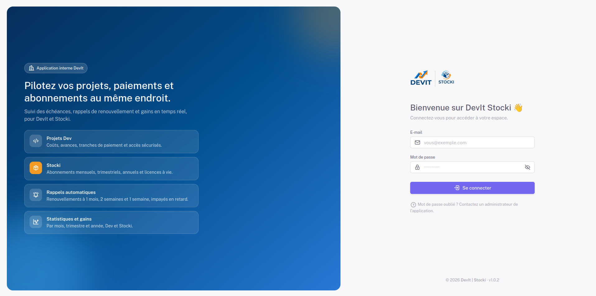
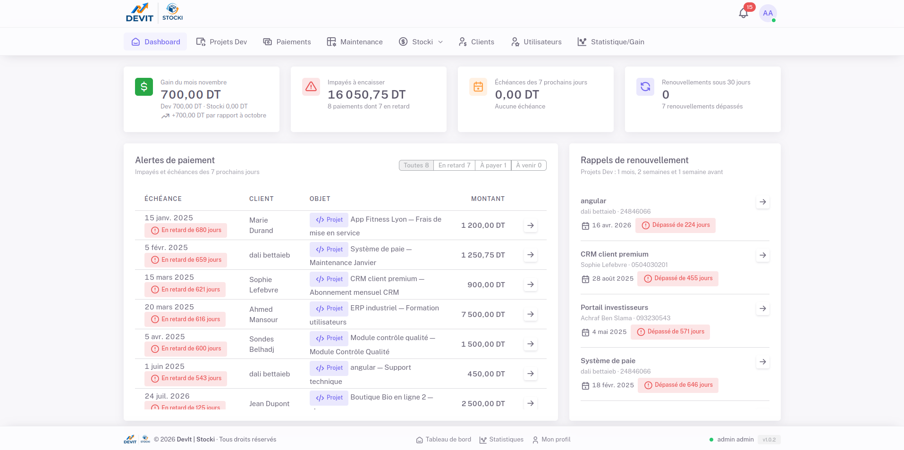
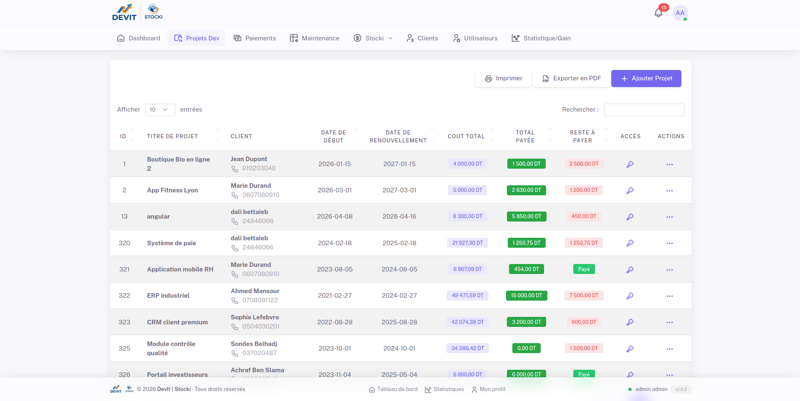
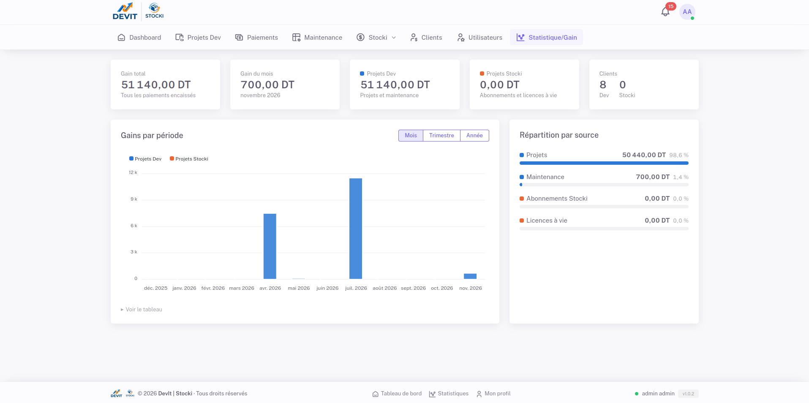

<div align="center">

# 🚀 DevIt | Stocki

**Internal platform for managing projects, client payments, maintenance contracts and software subscriptions.**


</div>

---

## 📌 Overview

DevIt Stocki centralizes DevIt's operational and financial activity in a single web application: clients, development projects, payment installments, maintenance contracts, Stocki subscriptions and revenue statistics.

Sensitive technical credentials attached to projects are stored encrypted (AES-256-GCM).

## ✨ Features

| Module | Description |
|---|---|
| 📊 Dashboard & Notifications | Monthly revenue, outstanding payments, upcoming deadlines, renewal reminders |
| 📁 Projects | Costs, advances, installments, renewal dates, encrypted technical credentials |
| 💳 Payments | Installments, statuses, outstanding balances, payment history |
| 🔧 Maintenance & Subscriptions | Monthly maintenance, Stocki subscriptions (monthly / quarterly / yearly), lifetime licenses |
| 👥 Clients | Client profiles with full financial history |
| 📈 Statistics | Monthly, quarterly and yearly revenue analysis |
| 🔐 Users | Account management with admin-based permissions |

## 🛠️ Tech Stack

| Layer | Technologies |
|---|---|
| Backend | PHP 8.4+, PDO, Composer, PHP dotenv |
| Database | MySQL 8+ |
| Frontend | HTML5, CSS3, JavaScript, Bootstrap 5, DataTables, Select2, ApexCharts, FormValidation |
| Server | Apache 2 with `mod_rewrite` |
| Security | Session authentication, `password_hash` / `password_verify`, AES-256-GCM, PDO prepared statements |

## 📸 Screenshots

<div align="center">

| Authentication | Dashboard |
|---|---|
|  |  |

| Project management | Statistics |
|---|---|
|  |  |

</div>

## 📂 Project Structure

```text
devitstocki/
├── app/          # Application code (Router in app/Router/Router.php)
├── database/     # SQL dump (schema + applied migrations)
├── logs/         # Application logs (writable by the web server)
├── public/       # Web entry point
├── screenshots/
├── .env.example
└── composer.json
```

## ⚙️ Getting Started

### Prerequisites

- PHP 8.4+ with extensions `pdo_mysql`, `mbstring`, `openssl`
- **MySQL 8+** (MariaDB is not supported: the schema uses the `utf8mb4_0900_ai_ci` collation)
- Apache with `mod_rewrite`
- Composer

### 1. Clone and install

```bash
git clone https://github.com/Dalikusjr/devitstocki.git
cd devitstocki
composer install --no-dev
```

### 2. Configure the environment

```bash
cp .env.example .env
php -r "echo base64_encode(random_bytes(32)), PHP_EOL;"   # generate APP_KEY
```

| Variable | Description |
|---|---|
| `DB_HOST` | Database host (e.g. `localhost`) |
| `DB_USER` | Database user |
| `DB_PASS` | Database password |
| `DB_NAME` | Database name (`db_devitstocki`) |
| `APP_KEY` | Base64-encoded 32-byte key used for AES-256-GCM |

> ⚠️ **Back up `APP_KEY`.** Without it, encrypted project credentials cannot be decrypted. Rotating it without re-encrypting existing data makes them unreadable.

### 3. Create the database

```sql
CREATE DATABASE db_devitstocki
  CHARACTER SET utf8mb4
  COLLATE utf8mb4_0900_ai_ci;

CREATE USER 'devitstocki'@'localhost' IDENTIFIED BY 'your_database_password';

GRANT SELECT, INSERT, UPDATE, DELETE ON db_devitstocki.* TO 'devitstocki'@'localhost';
```

```bash
mysql -u devitstocki -p db_devitstocki < database/db_devitstocki.sql
```

The dump contains the schema and all applied migrations.

### 4. Configure Apache

```bash
sudo a2enmod rewrite
sudo systemctl restart apache2
sudo chown -R www-data:www-data logs/
```

Place the project in `/var/www/html/devitstocki/`.

### 5. Open the application

```text
http://localhost/devitstocki/public/
```

> The base path is currently defined in `app/Router/Router.php`. If you deploy under a different path, update it there.

## 🔑 Demo Accounts

For local testing only. **Never deploy these accounts to a production environment.**

| Role | Email | Password |
|---|---|---|
| Administrator | `admin@devitstocki.com` | `Test0123` |
| User | `user@devitstocki.com` | `Test0123` |

## 🔒 Security

- Passwords hashed with `password_hash` / `password_verify`
- SQL injection mitigated through PDO prepared statements
- Project technical credentials encrypted at rest (AES-256-GCM)
- Role-based access (administrator / user)

## 👨‍💻 Author

**Mohamed Ali Bettaieb** — Backend Developer (PHP, Symfony, software architecture, security, DevOps)

[LinkedIn](https://linkedin.com/in/mohamed-ali-bettaieb) · [GitHub](https://github.com/Dalikusjr)

<div align="center">

DevIt Stocki · Internal Business Management Platform

</div>